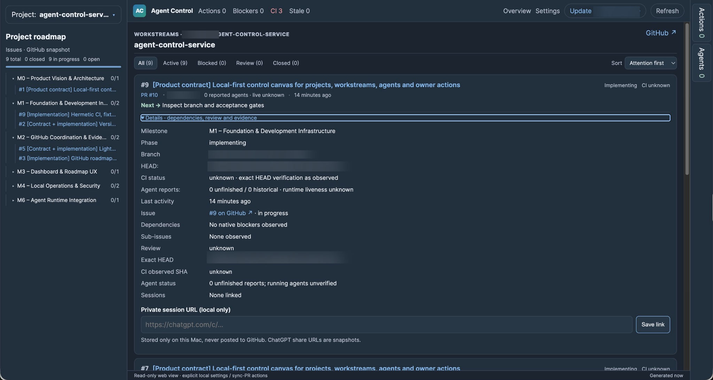

# Agent Control

**A local-first GitHub roadmap and activity dashboard for parallel software projects.**

This publication-oriented repository demonstrates Python backend development, GitHub API integration, FastAPI/Jinja user interfaces, background synchronization, CI-state presentation and cautious handling of unavailable or stale data.

*Screenshot of a point-in-time local dashboard; the statuses do not establish live agent execution.*

## Visible capabilities

- Project roadmaps organized by GitHub issues and milestones.
- Branch, pull-request, review and current-commit CI information.
- Conservative display of stale or unavailable GitHub observations.
- Local configuration, project selection and responsive browser UI.
- Optional separately authorized local operator maintenance and PR actions.

The dashboard observes ordinary GitHub issues **without requiring repository markers or a machine-readable agent protocol**. It does not inspect or orchestrate live ChatGPT/Codex processes and does not infer agent liveness from GitHub activity.

## Technical overview

Python 3.11+, FastAPI, Jinja, Pydantic, HTTPX, GitHub Actions, HTML/CSS/JavaScript. See [architecture](docs/architecture/overview.md), [features](docs/features.md) and [local setup](docs/getting-started.md).

The GitHub patch importer, machine-event publisher and cross-repository agent-rule synchronization are **not distributed** with this public-facing copy. Standard project CI remains.

## Local setup

Use an isolated Python environment, install the package from `pyproject.toml`, then run `agent-control config` and `agent-control start`. A configured GitHub CLI login can provide private-repository read credentials; permissions depend on the actual GitHub account.

The service is local-first; actual host deployment and private remote access require separate operator acceptance. The GitHub checkout and deployment are not evidence of a running agent.

## Licensing

**All rights reserved.** Source inspection is not a general license to use, modify, redistribute or commercially exploit this revision. See [LICENSE](LICENSE) for the precise terms; third-party rights are unaffected.
